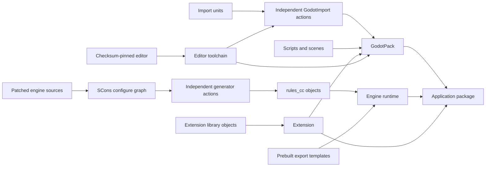

# Architecture

The project and pack API is in `godot/defs.bzl`; `godot/app.bzl` provides the unified
application API. Export platforms from `godot/platforms/defs.bzl` select the operating
system, CPU set and iOS environment. The application backends, the operating-system rules
`godot_app` selects, live under `godot/platforms/private/`. `godot_android_runtime`, exported
from `godot/engine/defs.bzl`, is in `godot/platforms/private/android.bzl`.
`godot_app` selects optional macOS signing through `//godot:macos_signing`; the private
signer is `godot/platforms/private/macos_signing.bzl`.
Providers in `godot/providers.bzl` join the independent build layers.

The application context, the values of a `godot_app` its pack's export depends on
(application ID, iOS minimum version and device families, Android SDK levels), reaches the
pack export through a transition, so applications that share it share one export. The
edge from an operation to its resources resets the application context, and native code
is reached with the project context reset too, so packaging and operations share the
providers of extension and platform libraries rather than rebuilding libraries or merging
duplicate manifests for each application identity or project.

Reusable `godot_resources` declarations describe resource membership, path
relationships, the add-ons their files use and one import unit each, independently of
processing. A `godot_addon` (`godot/private/addon.bzl`) declares an add-on once: its
runtime and editor parts, roles, extensions, platform libraries on a resetting
`<name>.platform_libraries` helper, and its contributions.
`godot_project` is a configuration context and holds no resources. Each operation
macro (pack, source run, test, check, editor view, metadata sync, resource graph)
declares an internal `godot_view` over its `deps` whose transition sets the
`//godot/private:project` context (`godot/private/context.bzl`). Every resources
target reached in that context imports its own importable files under the project's
import configuration, once per project and target platform; the view collects the
add-ons its resources use and those the project names, merges their runtime parts and
contributions with the project's configuration, stages their editor parts for the
processes of their roles, and initializes the members for the operation. A pack reaches
the extensions and platform libraries of those add-ons through an internal per-pack
native target, whose `deps` the aspects of rules_android and rules_apple follow. Import inputs remain available to the
final Godot scan without becoming export members. See [projects and resources](../public/resources.md) for configuration conflict rules
and cache boundaries.

## Reuse and decisions

- `rules_cc` owns C++ compilation, discovered header dependencies, archive/link
  actions and C++ toolchain resolution. `godot-cpp` uses its upstream
  binding generator with declared outputs and C++ compilation.
- `rules_swift` compiles the iOS engine's SwiftUI entry point with the selected
  Apple toolchain.
- `rules_python` supplies Python tools and interpreters; action tools require
  no globally installed Python packages.
- `rules_apple` owns iOS linking, platform transitions, SDK/framework selection,
  signing and IPA assembly. It also supplies the macOS codesigning tool.
- `rules_android` owns Android compilation, AAR resources, manifest merging,
  dexing, JNI and APK assembly; Maven dependency resolution belongs to
  `rules_jvm_external`.
- `rules_foreign_cc` does not support SCons as one of its delegated build
  systems. Wrapping an entire SCons build would also hide the required object
  cache granularity. A configure-only translation preserves Godot's existing graph
  while exposing its actual compile and generator actions to Bazel.
- Resources remain explicit. Reflection, dynamically assembled load paths and
  arbitrary GDScript make automatic inference of all used modules/resources
  unreliable. The application declares its asset and engine-module dependency
  sets; unknown engine modules fail configuration.

## Reproducibility

Resource identities never contain Bazel output paths. Build tools receive
explicit input manifests, copy only declared inputs and isolate Godot's HOME,
configuration, cache, temporary files and log. Diagnostics and output structure
are checked even when Godot reports exit status zero.
Run manifests contain all fields for the selected execution mode; missing required
fields fail explicitly. Desktop packaging consumes `GodotRuntimeInfo`, including
its operating system, executable and bundle files.

Desktop archive timestamps, order, permissions and ownership are normalized.
Signing is a separate action. Production certificate signing runs locally and
does not upload private keychain state to a remote cache.

Source graph configuration needs a host Python and installed target
SDK/tool probes. The repository rule can receive a declared Python label and
watches configuration scripts, patches and custom-module trees. Consequently
this configure phase is host-sensitive; it is not a claim of fully hermetic SDK
provisioning. Generated compile actions use Bazel's C++/Apple toolchains.

## Tests

White-box tests beside the implementation packages cover build contracts and
diagnostics; the regression module `tests/` exports and runs real projects as a consumer,
through the public module boundary and the artifact test rules of `godot/private/testing/`. Cache checks compare selected Bazel actions and output bytes.
Repository commands and controlled fixture inputs are documented in the
[fixture catalogue](verification-recipes.md#regression-fixtures).

## Primary references

- [Bazel toolchains](https://bazel.build/extending/toolchains)
- [rules_cc](https://github.com/bazelbuild/rules_cc)
- [rules_python](https://github.com/bazel-contrib/rules_python)
- [rules_apple](https://github.com/bazelbuild/rules_apple)
- [rules_android](https://github.com/bazelbuild/rules_android)
- [rules_foreign_cc supported systems](https://github.com/bazel-contrib/rules_foreign_cc)
- [Godot SCons build system](https://docs.godotengine.org/en/4.7/engine_details/development/compiling/introduction_to_the_buildsystem.html)
- [Godot command line export](https://docs.godotengine.org/en/4.7/tutorials/editor/command_line_tutorial.html)
