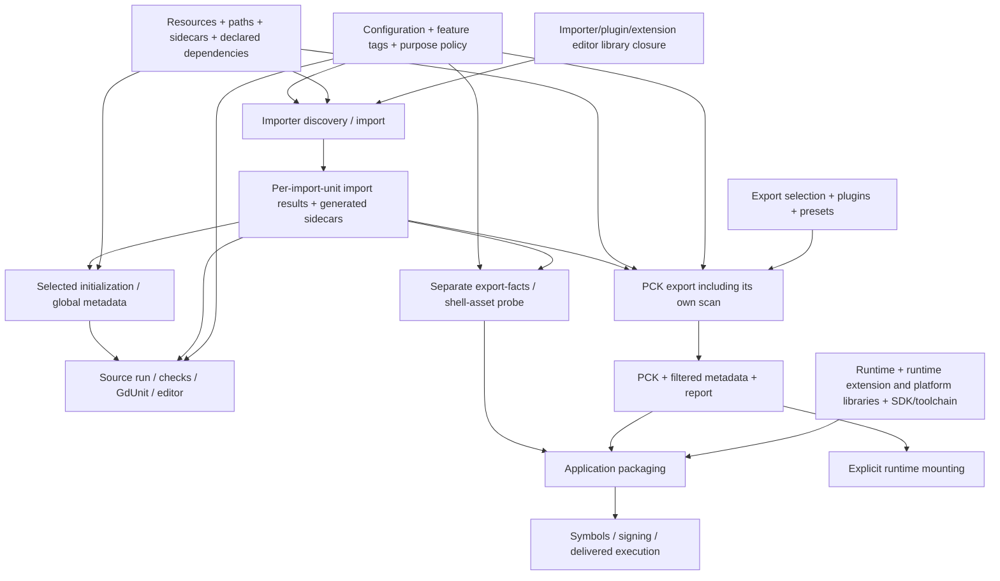

# Dependencies, Reuse and Invalidation

See [artifact classes](artifacts.md) and [operations](operations.md). Every edge below includes
tool/implementation/argument dependencies of the participating operations. D/C, F/R/E/I/U
are defined in [README](README.md). Transitive closures follow declared or established
references; arbitrary dynamic dependencies remain open rather than absent.

## Pipeline overview

This shows operation/data relationships, not exact Bazel targets or a mandatory serialized
schedule. In the current wrapper, PCK export and the export-facts probe rescan their staging;
there is no direct Bazel OP-INIT → OP-PCK/OP-SHELL artifact dependency.

## Conversion, metadata and validation edges

| Edge | Read → produced/affected artifacts | Condition and change consequence | Evidence |
|---|---|---|---|
| D01 | PROJECT + declared contributions/policy + relevant FEATURES → PURPOSE-CONFIG | D. A runtime setting edit may leave the import purpose's configuration bytes unchanged; do not equate all purposes. | F/R [S02](evidence.md#s02), [R02](evidence.md#r02) |
| D02 | ENGINE + import PURPOSE-CONFIG + active PLUGIN/EXT-DESC/EXT-LIBS → IMPORTABLE | D/C. Built-in/custom importer capability changes can change which import unit actions are needed. | R [R02](evidence.md#r02) |
| D03 | SOURCE bytes + NAMESPACE + IMPORT-SIDECAR/options/defaults/version + prerequisite imports → IMPORTED/sidecars | D. Relevant source/path/sidecar/importer changes affect conversion even if target role name stays the same. | F/R [S04](evidence.md#s04), [S06](evidence.md#s06), [R02](evidence.md#r02) |
| D04 | Group file/member sources/options or post-import scripts + closure → group/scene conversion | C. A change to one member may affect several outputs. Group dependency boundaries must be preserved before splitting work. | F [S04](evidence.md#s04), [S06](evidence.md#s06) |
| D05 | EDITOR-SETTINGS + external TOOLS/version/auxiliary files → IMPORTED | C. Blender and settings-driven importers are examples. Ordinary resource-only keys are insufficient for those importers. | F [S06](evidence.md#s06) |
| D06 | PROJECT application name + source MD5 + lowercased logical path + existing UID registry → generated UID-SIDECAR/UID-CACHE | C for path-based UID generation. Authored UID/cached identity may be preserved; generic ID generation may be random. No pure source-only identity claim. | F/E [S05](evidence.md#s05), [E01](evidence.md#e01) |
| D07 | Directory membership/ignore/nested project + declared phase closure + import results → CLASS/UID/EXT/FS metadata | D/C. Different selections can require different metadata despite sharing converted resources. Scene-group refresh additionally requires the appropriate editor path. | F/R [S04](evidence.md#s04), [S09](evidence.md#s09), [R02](evidence.md#r02) |
| D08 | Source/dest existence/mtime/MD5 + importer version/options + prior FS-CACHE → Godot reimport decision | C warm state. Engine cache optimization is separate from Bazel action key/result validity. A stale/missing cache cannot silently prove conversion valid. | F [S04](evidence.md#s04) |
| D09 | IMPORT-RESULT/INITIALIZED + ownership/checkout identity → SIDECAR-LIST → authored sidecars | D then explicit writeback. Existing authored files are not overwritten; later declarations/imports use those new inputs. | R [R03](evidence.md#r03) |
| D10 | Source environment/global metadata + own cases/framework/warnings/filter/shard → CHECK/GDUNIT result | D/C. Helpers/framework are availability, not implicit candidates; autoload/preload/static code/extension library/external state can affect result. | F/R [S03](evidence.md#s03), [S13](evidence.md#s13), [R04](evidence.md#r04) |
| D11 | Editor view recipe + actual checkout/persistent preferences/user actions → checkout/config/cache changes | D/C. Interactive effects cannot be represented as a previously cached build result. | F/R [S06](evidence.md#s06), [R03](evidence.md#r03) |

## Export, application and runtime edges

| Edge | Read → produced/affected artifacts | Condition and change consequence | Evidence |
|---|---|---|---|
| D12 | GRAPH + config roots/explicit relations/exclusions/optional membership + required identity metadata → SELECTION | D/C. Unknown dynamic/opaque refs need declarations or conservative treatment. Graph output does not retroactively narrow action inputs. | R [R06](evidence.md#r06) |
| D13 | Export PURPOSE-CONFIG + PRESET + FEATURES + source/imports + active export plugins → EXPORTED/PCK/REPORT | D/C. Variants, remaps, script mode and plugin callbacks change packed content. Current wrapper rescan can reimport first. | F/R [S08](evidence.md#s08), [S10](evidence.md#s10), [R02](evidence.md#r02) |
| D14 | Global class/UID/extension information derived/read in export staging + selected paths → filtered PCK metadata | D/C. Current wrapper derives it in its export rescan; do not assume it directly consumes project's initialized tree. | F/R [S08](evidence.md#s08), [R01](evidence.md#r01), [R02](evidence.md#r02) |
| D15 | Export customization inputs + cache policy → EXPORT-CACHE/transformed resources | C. Plugin-generated resources and .godot/exported are distinct from reusable resource imports. | F [S08](evidence.md#s08) |
| D16 | Encryption key/filter/seed/credentials/env or true patch base bytes → PCK encoding/contents | C upstream facility. Random IV can affect reproducibility without a seed. Not equivalent to current required_packs metadata and not automatically exposed by wrapper preset. | F/R [S08](evidence.md#s08), [S12](evidence.md#s12), [R02](evidence.md#r02) |
| D17 | Active renderer/backend/compiler + shader source/settings/features → shader cache/baked PCK members | C only when facility is active. Headless invocation alone does not establish every shader path active or inactive. | F/U [S07](evidence.md#s07), [S12](evidence.md#s12) |
| D18 | Export setup + action plugin with shell probe + default/source images + engine profile/tools → EXPORT-FACTS, SHELL-ASSETS/FILES | D/C. Current export-facts probe is a separate lazy export, not metadata parsed from final PCK. | R [R08](evidence.md#r08) |
| D19 | EXT-DESC + loading engine's feature/path/dependency set (+ autodetect directory listing) → loaded library/registered types/importers | C phase active. Changes can invalidate import/init/export/check as well as run. Physical library availability does not imply registration. | F/R [S09](evidence.md#s09), [R05](evidence.md#r05) |
| D20 | PCK + RUNTIME + runtime EXT-LIBS/PLATFORM-LIBS + shell files/assets/toolchain → APPLICATION | D/C. A change only to the runtime or its extension libraries may preserve PCK bytes while changing packaging and execution inputs. | R [R05](evidence.md#r05) |
| D21 | Native object/binary/link state + strip/symbol tools → stripped binaries + SYMBOLS | D/C. Preserve build IDs/UUIDs; symbol changes and application changes need not require resource import. | R [R05](evidence.md#r05) |
| D22 | Unsigned app + SIGNING refs/policy/tools/external keychain → SIGNED | D/C. Signing-only edits need not invalidate imports or PCK. Mode determines caching/locality. | R [R05](evidence.md#r05) |
| D23 | Main/delivered extra PCK bytes + load order/replace flag/offset + resource/class/UID process state → PACK-STATE | D/C. Existing loaded objects may outlive replacement; class-list inspection differs from registry entries. No automatic settings/autoload/extension-list activation. | F [S02](evidence.md#s02), [S05](evidence.md#s05), [S09](evidence.md#s09) |
| D24 | Loaded or linked extension registration + main/delivered packs + LAUNCH + actual EXTERNAL state → execution result | D/C. Result validity includes the runtime and library environment beyond unchanged PCK bytes. | F/R [S03](evidence.md#s03), [R04](evidence.md#r04), [R05](evidence.md#r05) |
| D25 | Plugin/application arbitrary IO or custom output outside captured roots → affected phase/result | U. Make dependency/output contracts explicit, isolate or restrict support. The catalogue does not certify arbitrary plugin IO. | F/R/U [S06](evidence.md#s06), [S08](evidence.md#s08), [R02](evidence.md#r02), [B03](evidence.md#b03) |

## Current conservative action edges versus selected output

| Current implementation | What remains an input | Consequence |
|---|---|---|
| GodotPack and GodotShellAssets | Full project.files plus project.imports and generated export setup | An excluded/unselected source can still invalidate action input keys today. Smaller PCK membership alone proves no avoided work. |
| Source run/check/test | Full project.files/imports/INITIALIZED | Unrelated application files can still enter test runfiles. Revised selection precision is not already implemented. |
| Per-import-unit import | Import unit input/resource path closure, prerequisite trees, active import-plugin closure/config/toolchain and suffix probe | Other independent import units need not be inputs, but plugins/group imports genuinely widen the closure. |
| Graph scanner | All declared graph inputs; bounded format analysis | Static inference is not a mechanism for adding Files to analysis dependencies. |
| Runner for packs | Extension library resource paths of the main pack's project plus extra PCK bytes | Extension library requirements of extra packs are not automatically aggregated. |
| Output retention | Import unit: changed converted files + own sidecars; init: changed staged files; export: PCK/report | An upstream output existing does not establish the wrapper retains it or can reuse it. |

Sources: [R01](evidence.md#r01), [R02](evidence.md#r02), [R04](evidence.md#r04), [R06](evidence.md#r06).

## Reuse criteria and representative edits

These are correctness conditions (I), not completed feature performance measurements.

| Edit / context difference | Work that may remain reusable | Work/results that must reflect the change |
|---|---|---|
| No changed declared inputs or execution conditions | Compatible action outputs and deterministic test results | Live external results follow their actual validity policy |
| Independent import unit/content changes | Other imports/native compilation and independent deterministic suites | Its own conversion/dependent imports/metadata/export/tests as established by edges |
| Logical resource path/project name or UID sidecar changes | Truly independent native code | Relevant UID/remap/import/global metadata and references |
| Runtime-only setting absent from the import purpose's configuration with no other actual read | Unchanged import outputs | Runtime/editor/export/config-dependent execution |
| Importer/plugin/extension editor library code, options or external tool changes | Other contexts/phases proved independent | Affected discovery/conversion/metadata/export/execution |
| Suite candidate/filter changes with same required closure | Conversion outputs under equal effective import context | Case selection/report/result; initialization only where closure/phase changes |
| Export-only feature/script mode/selection/preset changes | Earlier import result whose complete inputs stay equal | Export/shell facts/assets and dependent app/results; export rescan can need conversions |
| Extension runtime library or runtime changes | Resource imports/PCK if no import/export-phase use | Application packaging/symbol/loading/execution inputs |
| Signing identity/entitlements changes | Compilation/imports/PCK/unsigned product | Signed artifacts and applicable validity |
| Mount order/replace behavior or external operating-system state changes | Potentially all build artifacts | Relevant runtime/test behavior and result validity |

Runtime/autoload naming is not itself proof of import independence: a unit/importer may
genuinely read that resource through another edge.

## Requirements for automatic import sharing

A plausible reusable import identity includes actual engine/tools; the import purpose's effective
configuration and active feature tags; logical paths/source/sidecars/import options;
dependency conversion/group closure; importer/plugin/extension editor library code and
actual auxiliary tool/state. UID generation and captured-output contracts must also be
respected. This is a semantic checklist, not a finalized key encoding or a new cache
implementation.

**Inference:** configured resource aspects could own import actions, and explicit dependency
edges could restrict their selected inputs. This follows from the configured graph and
action mechanisms in [B01](evidence.md#b01) and [B02](evidence.md#b02); suitability for real
Godot imports remains unverified. The historical [E02](evidence.md#e02) notes lack a durable
reproduction recipe and are not independent evidence for this inference or a public API.

Open choices remain: resolving global/sibling contributions before imports, group atomicity,
dependency declarations for arbitrary plugins, transporting context without unrelated native
configuration multiplication, and safely sharing conversion independently of selected
initialization. A public godot_imports target is not established as necessary by this catalogue.
